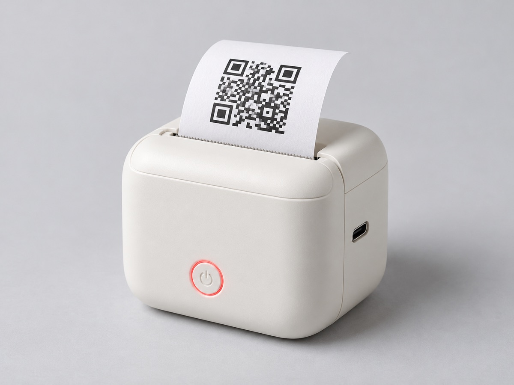

# Printer Ticket Skill

**A [Claude Code](https://claude.com/claude-code) skill for pocket thermal sticker printers.** Ask Claude to print a
QR code, a label, a note or a photo, and it comes out of the printer. Ships with `print-ticket`, the Linux command the
skill drives, which also works on its own and on a schedule.

<p align="center">
  
  &nbsp;&nbsp;
  
</p>
<p align="center"><sub>Left: illustration (generated image). Right: what <code>print-ticket --qr --caption printer-ticket</code> sends to the printer.</sub></p>

## In 10 seconds

```sh
git clone https://github.com/NoeBrt/printer-ticket-skill ~/printer-ticket-skill && ~/printer-ticket-skill/setup.sh
```

Then, in Claude Code:

> print a QR code for https://example.com with the caption "Example"

## Features

| | Feature | Command |
|---|---|---|
| ✅ | Claude Code skill: "print this QR", "imprime une étiquette", "print the date every morning" | `skills/printer-ticket` |
| ✅ | One-shot setup: checks tools, installs TiMini Print, finds and pairs the printer, installs the skill, prints a test | `./setup.sh` |
| ✅ | Health check: re-running setup skips what is done and reports the first broken step | `./setup.sh` |
| ✅ | QR code from stdin, as large as the head allows, with a caption | `echo URL \| print-ticket --qr --caption TEXT` |
| ✅ | Text | `print-ticket --text "Shelf B"` |
| ✅ | Photos (Floyd-Steinberg dithering) and PDFs | `print-ticket photo.png`, `print-ticket doc.pdf` |
| ✅ | Anything on stdin, type detected (PNG, JPEG, PDF, text), e.g. from another machine | `cmd \| ssh host 'print-ticket -'` |
| ✅ | Regular prints with cron, with a log | `print-ticket schedule "0 8 * * 1-5" 'CMD'` |
| ✅ | Secrets stay out of argv and are not kept: stdin only, 0600 temporary files deleted after printing | |

## Supported printers

| Status | Printers | Setting |
|---|---|---|
| ✅ Tested | **Printel X6** (model X6, Bluetooth name `YHK-1536`, JieLi chip) | default |
| 🟡 Same protocol profile, untested | CTP-500 and its clones advertised as `YHK…`, `CorePrint`, `Teal Printer`, `Purple Printer`, `B Pink Printer`, `P Pink Printer`, `Cherry Printer`, `Floral Printer`, `Check Printer`, `Smiley Printer`, `Stone Printer` | `PRINTER_NAME="<Bluetooth name>"` |
| 🟡 Other TiMini Print printers, untested | About 80 models (cat printers GB0x/MX0x, X5/X7/X8, D11, P1/P11, LY0x, …), see [TiMini's list](https://github.com/Dejniel/TiMini-Print#supported-printer-models) | `PRINTER_NAME=... PRINTER_MODEL=<model key>` |

These printers are sold under many brand names: what counts is the Bluetooth name the printer advertises
(`bluetoothctl devices`). Tested one? Open an issue or a pull request to move it to ✅.

## Requirements

- Linux with BlueZ: `bluetoothctl`, `sdptool` (`bluez-deprecated-tools` on recent Ubuntu)
- Python 3 with venv, git; cron for schedules
- [Claude Code](https://claude.com/claude-code) for the skill (the command works without it)

`setup.sh` says what is missing. macOS is not supported as the print host (see [How it works](#how-it-works)); a Mac
can print through a Linux machine over `ssh`.

## Installation

### One command (recommended)

```sh
git clone https://github.com/NoeBrt/printer-ticket-skill ~/printer-ticket-skill
~/printer-ticket-skill/setup.sh
```

It installs the TiMini Print fork in `~/TiMini-Print`, links `print-ticket` into `~/.local/bin`, pairs the printer
(turn it on first, PIN `0000` if asked), copies the skill to `~/.claude/skills/` and prints a test sticker. Run it
again whenever printing stops working.

### Skill only, with npx

When `print-ticket` is already installed on the machine, or on another machine Claude reaches over `ssh`:

```sh
npx skills add NoeBrt/printer-ticket-skill                  # pick the agent interactively
npx skills add NoeBrt/printer-ticket-skill -a claude-code -g
```

### Manual

```sh
git clone https://github.com/NoeBrt/printer-ticket-skill
cp -r printer-ticket-skill/skills/printer-ticket ~/.claude/skills/
```

### Settings

| Variable | Default |
|---|---|
| `TIMINI_DIR` | `~/TiMini-Print` |
| `PRINTER_NAME` | `YHK-1536` (Bluetooth name) |
| `PRINTER_MODEL` | `instaprint_ctp500_coreprint` (TiMini model key) |

## Try your first prompt

> print a QR code for https://example.com with the caption "Example"

> imprime une étiquette "Étagère B · piles"

> print this photo on my sticker printer: ~/Pictures/cat.jpg

> print today's date on the sticker printer every weekday at 8

Claude says what it sent and asks you to check the sticker: nothing reports success from the paper itself.

## Command line

```sh
print-ticket --text "Shelf B · batteries"
print-ticket photo.png                      # Floyd-Steinberg dithering
print-ticket label.pdf
echo "https://example.com" | print-ticket --qr --caption example.com
ssh printer-host 'print-ticket -' < photo.png                # from another machine
```

TiMini options pass through (`--darkness 1-5`, `--verbose`). A 50 mm QR sticker takes about 1.5 s to send.

### Regular prints

`schedule` takes a cron time and any shell command; `%` needs no escaping. Output goes to
`~/.cache/print-ticket.log`.

```sh
print-ticket schedule "0 8 * * 1-5" 'date "+%A %d %B" | print-ticket -'                 # date every weekday morning
print-ticket schedule "30 7 * * *" 'curl -s "wttr.in/Paris?format=3" | print-ticket -'     # weather
print-ticket schedule "0 9 * * 1" 'cat ~/todo.txt | print-ticket -'                      # weekly todo list
print-ticket schedule list
print-ticket schedule remove 2
```

## How it works

| Piece | Role |
|---|---|
| `skills/printer-ticket/SKILL.md` | The skill: when to trigger, how to print, schedules, secrets, troubleshooting. |
| `print-ticket` | Bash wrapper: printer name and model, dithering, QR and stdin handling, schedules, 180 s timeout. |
| `render-qr.py` | QR code (ECC M) as large as the 384-dot head allows, with an optional caption. |
| `setup.sh` | Install, pairing, skill and test print; re-runnable. |
| [TiMini Print](https://github.com/Dejniel/TiMini-Print), [fork with one fix](https://github.com/NoeBrt/TiMini-Print/tree/linux-sdp-serial-port-search) | Open source CLI that speaks the printer protocol. |

Findings on the Printel X6 (JieLi chip):

- **Classic Bluetooth only.** Over BLE it feeds paper but prints nothing. It prints over classic SPP, service
  `JL_SPP` on RFCOMM channel 2.
- **Why the fork.** Its SDP record is outside the public browse group, so `sdptool browse` finds nothing and TiMini
  falls back to BLE. The fork also tries `sdptool search --bdaddr <addr> SP`, which finds channel 2 (commit
  [`324f1de`](https://github.com/NoeBrt/TiMini-Print/commit/324f1de), with a regression test).
- **A Linux host that stays on.** macOS can print over its classic serial port, but the port hangs after a printer
  restart.

## Troubleshooting

- **Paper feeds, nothing prints:** the job went over BLE; run `./setup.sh` and check the fork is installed.
- **Printer not found:** it is off, or connected to a phone or laptop; disconnect it there.
- **Stops halfway:** turn the printer off and on, retry.
- **Pale:** `--darkness 5`; the heat-sensitive side of the roll must face the head.

## Roadmap

- Batch labels: one sticker per CSV line (asset tags, guest Wi-Fi QR)
- Templates: title, QR and date on one sticker
- Print queue over HTTP on the LAN, for phones and machines without ssh
- Battery and paper status before printing

## License

Apache-2.0, like TiMini Print.
